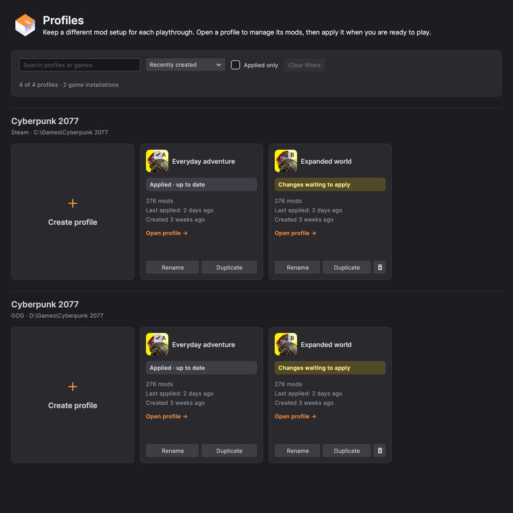

# Profiles, installation, and experimental game compatibility

This increment builds on the Windows stability work. Windows x64 remains the primary target. The compatibility below describes implemented behavior and automated fixtures; it does not certify a real game version, mod collection, or playthrough.

## Profiles

The home navigation now opens **Profiles**. Each game installation has its own section, with its store and path shown so two installed copies are distinguishable.

- **Create profile** asks for a name before creating a clean mod setup.
- **Duplicate** copies installed items, nested collections, local disabled settings, library links, conflict priorities, and game load-order records. Downloads remain shared in the library. The new profile starts unapplied.
- **Rename** updates the saved name. Names are trimmed, limited to 100 characters, and cannot be empty or contain control characters. The dialog explains validation errors and keeps acceptance disabled until the input is valid.
- Search matches a profile name or game name. Sort by creation date, name, or applied profile first. **Applied only** filters to the profile currently associated with each installation; its card still shows whether changes are waiting to apply.
- Cards distinguish an up-to-date applied profile, pending changes, a profile ready to apply, and status lookup failure. Last-applied information updates from live data.
- Rename, duplicate, delete, and open are separate controls. Failed operations restore the controls and show an error. Delete requires confirmation and is blocked for the last or currently applied profile.

A profile is a mod configuration. This increment does **not** add separate save directories, automatic save copying, or complete per-profile INI isolation. The application already has game-specific managed locations; those remain the boundary of file deployment.

### Interface preview

The following capture renders the actual Avalonia Profiles controls with sample data. The two sections demonstrate separate Steam and GOG installations of the same game. Layout and action separation are also exercised at a narrower desktop width.

[View the compact layout](images/profiles-compact-preview.png).

### Copy consistency and recovery

A copied profile owns independent mutable entities. References inside target paths and packed load-order parent fields are remapped to the copied entities. External references to immutable library records and the game installation stay shared. Applied timestamps and game deployment receipts are not copied.

The copy first reserves permanent IDs using marker-only records, then publishes the complete graph in a single transaction. UI and load-order observers never receive a half-built profile. Cancellation and failure clean up reservations; startup recovers reservations left by an interrupted session. Recovery preserves any published data if it encounters an unexpected stale marker.

Copying rejects invalid cross-profile parent links, invalid load-order parents, broken priority targets, and parent cycles. It does not repair historical database corruption. Short labels are allocated against the commit's database state, and initial game management/profile ingestion is serialized to avoid duplicate metadata and conflicting first profiles.

Deletion checks cancellation before changing the profile. If deactivation fails, the profile remains available. The final removal uses the latest committed graph so external files ingested during deactivation do not leave orphaned mod records. Removed cards release their subscriptions and image resources without invalidating the UI framework's later deactivation callback.

## Collections and mod installation

Collection installation now retains successfully installed children for retry and reports incomplete work truthfully. Required failures leave the collection disabled. Selected optional failures are reported separately; a collection whose required items are complete may remain enabled. Cancelling the parent cancels the running child and waits for it to settle before exiting.

Entries follow manifest order so later installers can see earlier committed prerequisites. Retrying skips entries whose installation metadata is already committed. This is recovery from a failed or cancelled attempt while the database remains valid; it is not a persistent job queue across process crashes.

FOMOD installers use separate execution state for each installation. Presets are matched to named steps, groups, and options; hidden steps, empty recorded choices, invalid selections, and cancellation are handled explicitly. Callback failure closes the installer and propagates the failure instead of leaving an unresolved dialog.

Dependency checks describe the target profile's intended files, including unapplied changes, rather than claiming every file is installed. The temporary disabled parent of the collection currently being installed is treated separately from deliberately disabled mods. Executable version information is used when it can be obtained; unsupported script-extender or script functions do not report fabricated success.

Replicated collection payloads can use a standalone library file as well as an archive. Missing or ambiguous file hashes fail before publishing installation records. Installer destination validation rejects traversal outside the intended game directory.

The winning-file query now follows enabled ancestors recursively. Disabling an outer collection suppresses files in nested collections and groups; unrelated enabled siblings remain active. Invalid parent graphs fail closed rather than making their files deployable.

## Compatibility matrix

Enable **Show experimental games** on **My Games** to see experimental integrations. The setting persists and updates the page immediately. Experimental labels appear on both installed and available game tiles. The stable allowlist has not been expanded by this increment.

| Game | Implemented in this increment | Important boundary |
| --- | --- | --- |
| Skyrim Special Edition / Anniversary executable family | Safer Data/wrapper/BSA archive mapping; script-extender root placement; real plugin-header validation; deterministic dependency/master ordering; missing or disabled master diagnostics; preservation of the pre-management baseline; GOG-specific AppData location. | Experimental. No LOOT masterlist rules, independent plugin activation/order editor, persistent import of external plugin choices, Creation Club `.ccc` handling, or SKSE/DLL runtime validation. Original Skyrim and Skyrim VR are outside this integration. |
| Fallout 4 | Safer Data/wrapper/BA2 archive mapping; F4SE root placement; plugin-header/master ordering and diagnostics; preservation of the pre-management baseline. | Experimental. No LOOT masterlist rules, independent plugin activation/order editor, `.ccc`/INI test-file handling, plugin-slot-limit checks, or F4SE/DLL version validation. A fixture passing does not certify classic versus updated game runtimes. |
| The Witcher 3: Wild Hunt | New Steam/GOG identifiers, game locations, executable selection, standard Mods/custom DLC archive installer, script overlap diagnostics, and retained initial-file baseline. Launch chooses `bin/x64/witcher3.exe`, with the DX12 path as a fallback when the DX11 executable is absent. | Experimental. No `mods.settings` editor, automatic script/XML/menu merging, Steam Workshop subscription management, or game-version compatibility certification. The executable selection path is tested with a controlled process runner. |
| Stardew Valley, Cyberpunk 2077, Baldur's Gate 3, Bannerlord | Existing integrations remain. Shared collection, profile, FOMOD, and enabled-state fixes apply where those features are used. Per-game sort-order managers now keep their own registrations and subscriptions. | These are inherited integrations, not newly certified versions or modpacks. Existing REDmod lifecycle regressions remain part of the validation gate. |

### Bethesda plugin behavior

The plugin analyzer parses binary TES4 headers with the existing Mutagen readers. It handles `.esm`/`.esl` forced-master behavior and the master flag inside `.esp` files. Dependencies load before their dependants; unrelated items have deterministic filename ordering. Installed official base/DLC plugins follow their fixed ordering and are omitted from the generated activation list where the game supplies their activation.

Malformed headers, unavailable masters, and cycles stop apply before mutating the current deployment. Target-profile validation also runs before deactivating the previous profile, with refreshed disk metadata so an unchanged base master with a new timestamp is still readable. Intrinsic configuration is generated into a sibling temporary file before replacing its destination, so a writer failure cannot truncate the existing file.

Successfully generated configuration is recorded in the applied disk baseline with its content hash, size, and timestamp. This fixes a lifecycle defect where a generated plugin list could be mistaken for a new external file on the next apply and stop updating when mods were installed or disabled.

This handles hard header constraints. It does not reproduce LOOT's conflict metadata, groups, record-overlap analysis, or user rules. While managed, activation still follows effective enabled files. An original `plugins.txt` with comments and inactive entries is preserved for restoration, but those choices are not yet a separate editable activation model.

### Witcher archive behavior

The automatic installer accepts complete, unambiguous packages containing `Mods/mod*/content` and custom `DLC/*/content`, direct mod/content layouts, mixed mod/DLC packages, and a single common wrapper. Documentation files may be left out. Case-colliding destinations, file/directory collisions, unsafe Windows paths, alternate variants, and unsupported game-root payloads are rejected as a complete automatic plan and routed to the existing advanced installer.

Original expansion/DLC folder replacements require manual review. User documents and saves are outside the Witcher managed locations. An existing `mods.settings` can still affect game behavior; this integration does not rewrite it. Loose `.ws` files with different contents at the same relative script path in different enabled mod folders produce a warning. That warning is not a script merger or proof that a specific merge is required.

## Preserving existing game files

Skyrim SE, Fallout 4, and Witcher 3 opt into the installation's retained initial disk snapshot. Files present before management remain part of the base state even when the external hash catalog does not know their game build. This includes pre-existing manual mods; they are part of the retained baseline until explicitly changed through the app.

Before deleting or overwriting an unarchived original, including an intrinsic configuration file, the synchronizer requires a backup. Required backups finish before destructive actions. Profile switching and unmanage restore the retained originals, including the exact original Bethesda `plugins.txt`, or remove a generated-only list when no original existed. Excluded files are not removed by parent-directory cleanup: only genuinely empty directories are deleted.

The inherited backup batch cap is **5 GB**. A required preservation backup exceeding that cap aborts before replacement or deletion; unrestricted large-file/full-game backups are not implemented. Normal initial management records unchanged base-file hashes without duplicating the entire game. The optional full-backup setting can encounter the same cap.

This is narrower than complete transaction rollback after power loss, disk failure, or process termination during every apply step. Keep the separate App Rework database and archive storage together; deleting them can discard restoration data.

## Validation

The new offline fixtures exercise actual archives, database records, generated configuration, and filesystem synchronization rather than requiring a live Nexus account or installed game. They cover:

- Named create/copy/rename, atomic independent graph copies, concurrent creation/copy, cancellation, corrupted parent rejection, and reservation recovery.
- Profile search/sorting/live updates, command failure recovery, dialog validation, separate action-button behavior, and native Avalonia layout at two widths.
- Required/optional collection failures, cancellation propagation, retries, raw-file replication, FOMOD presets, concurrent installer sessions, and dependency state.
- Skyrim/Fallout archives, real TES4 plugin headers, master/dependency diagnostics, failed apply preservation, intrinsic writer failure, and exact original configuration restoration.
- Witcher archive routing, discovery metadata, controlled launch, script overlap diagnostics, profile switching/unmanage, retained original assets, ignored siblings, and large-backup guards.
- Per-game sort-order isolation and recursive disabled-state deployment.

Exact execution results and the corresponding source commit are recorded in the pull request and Windows CI artifact. A successful suite still needs real Windows testing with declared game editions, mod archives, collection revisions, script extenders, store clients, and user workflows before compatibility can be promoted.

## Sources and attribution

The game-specific implementation is local work informed by primary documentation. Existing GPLv3 notices and prior port attributions remain in [the continuation record](REWORK_ROADMAP.md).

- [LOOT: introduction to load orders](https://loot.github.io/docs/help/introduction-to-load-orders/) and [how LOOT sorts plugins](https://loot.readthedocs.io/en/latest/app/sorting.html): hard master/dependency rules and the distinction between those rules and full metadata-based sorting.
- [libloadorder game settings](https://github.com/Ortham/libloadorder/blob/master/src/game_settings.rs): official Skyrim/Fallout plugin lists. [LOOT GOG support discussion](https://github.com/loot/loot/issues/1802): Skyrim GOG's separate settings directory.
- [CD PROJEKT RED: managing mods](https://cdprojektred.atlassian.net/wiki/spaces/W3REDkit/pages/36339714) and [DLC mods](https://cdprojektred.atlassian.net/wiki/spaces/W3REDkit/pages/6328346): Witcher mod layout, `mods.settings`, original DLC names, and the separate Workshop location.
- [CD PROJEKT RED REDkit changelog](https://cdprojektred.atlassian.net/wiki/spaces/W3REDkit/pages/12058625/Changelog): newer script and XML override mechanisms make blanket claims about Script Merger inappropriate.
- [Nexus Mods' Vortex Witcher extension, commit `cf98b44`](https://github.com/Nexus-Mods/vortex-games/blob/cf98b44ab56b958660d4a688fd95beacd726ddff/game-witcher3/index.ts): store identifiers and executable layouts. Only factual identifiers/layout were reused; the installer and synchronizer are local implementations. The game tile uses the repository's neutral placeholder, not official game artwork.
